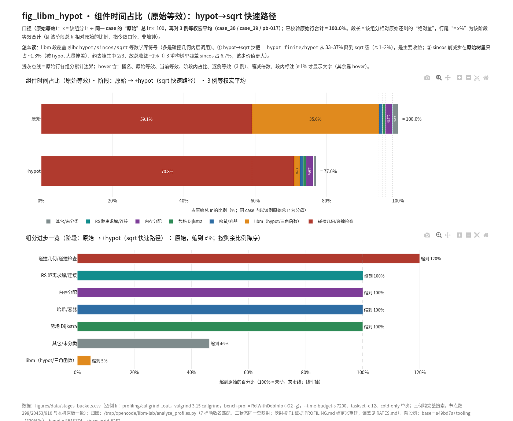
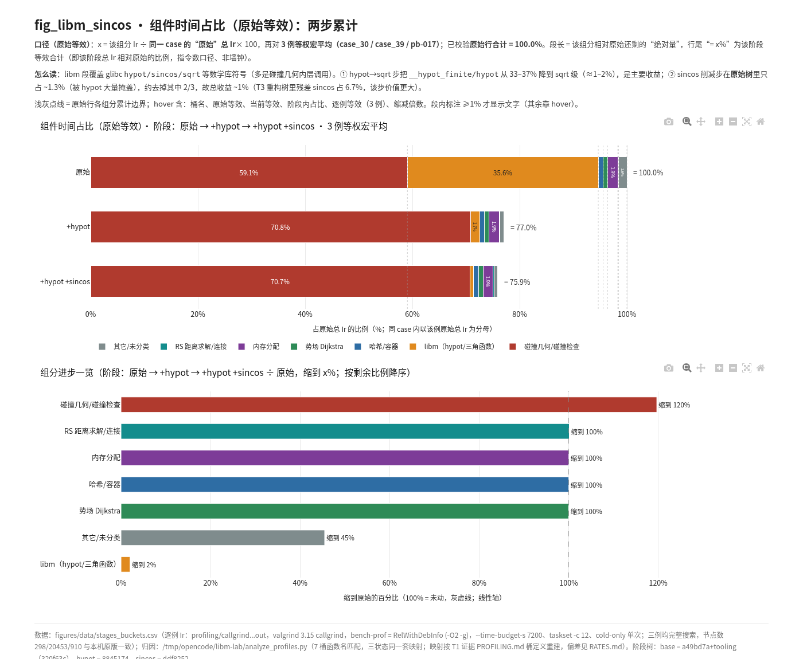

# libm 两步提速总结：hypot→sqrt 与 sincos 削减（ros_free）

> 仓库：`/home/gray/Planner/HybridAStarSpeedUP`（分支 `libm`，基线 = NewStructPlanner 原始 ros_free 快照）
> 本文汇总两处改动的**代码、实测提升率、剖析数据与配图**；完整原始数据见 `RATES.md`、`timing/`、`profiling/`、`figures/data/`。
> 测试口径：v3+v4 全量 166 例、三个状态轮转交错（R1 原始→hypot→sincos；R2 错位轮换…）、jobs=1 绑核、冷启动、每状态 3 样本取 P50。

---

## 0. 结论速览

| 步骤 | 提交 | 全 166 例几何平均 | 全 166 例求和口径（ΣP50） | 旧 16 例锚定子集 |
| --- | --- | ---: | ---: | ---: |
| ① hypot → sqrt 快速路径 | `8845174` | **1.261×（−20.7%）** | **1.361×（−26.5%）** | 1.262× |
| ② sincos 重复计算削减 | `ddf8252` | **1.010×（−0.9%）** | **1.013×（−1.3%）** | 1.010× |
| 累计（原始 → +sincos） | — | **1.273×（−21.4%）** | **1.378×（−27.4%）** | 1.275× |

P50 耗时求和：**268.6 s → 197.4 s → 194.9 s**（166 例全量串行、冷启动）。

三条要点：

1. **hypot 是这两刀里的绝对主力**——单项就砍掉约四分之一的总耗时；
2. **sincos 看着小，是因为被 hypot 掩盖**：原始代码里 sincos 自身只占约 1.3% 的指令数；hypot 移除后它的相对价值才显现（此前在"碰撞重构后"的代码上，残差口径约 7%）；
3. **两步都保持完全等价**：路径 720 个点位值 bitwise 全等（max|Δ|=0）、状态翻转 0、ctest 各 239/239、498 次 trial 全部 success；搜索行为零变化（节点数/碰撞检查数三状态逐位一致）。

---

## 1. 改动一：hypot → sqrt 快速路径（提交 `8845174`）

### 1.1 为什么动它

剖析（callgrind，宏平均 3 例）显示：原始代码里 `libm hypot/三角函数` 桶占 **35.6%** 总指令，是除"碰撞几何"之外的最大单项。而 `std::hypot` 为了处理极大、极小、无穷、下溢等极端输入，内部做了大量缩放与分支——对停车场场景的米级坐标完全是过度防御。

### 1.2 代码（`Src/collision/src/geometry.cpp`）

新增快速路径 + 域外回退：

```cpp
// 快速斜边（热路径上 std::hypot 占比高：callgrind 显示 case_39 约 22%，
// 其中 90% 以上来自这里替换的四个距离函数）。取值范围：
//   * 常规域 |dx|,|dy| ∈ [1e-150, 1e150)：dx²+dy² 无溢出（< 2e300 <
//     DBL_MAX）且不会被舍入到 0（≥ 1e-300 ≫ 最小次正规 4.9e-324），
//     sqrt 为 IEEE 正确舍入，与 glibc hypot 的差异仅在最后一位舍入
//     （hypot 在 glibc 2.31 不保证正确舍入）；
//   * 该域之外（inf/nan/极大值/两分量同为极小值）一律回退 std::hypot，
//     因此极端输入的返回值与标准库逐位一致。
constexpr double kHypotFastMax = 1.0e150;   // (1e150)² = 1e300
constexpr double kHypotFastMin = 1.0e-150;  // (1e-150)² = 1e-300

double hypot_fast(double dx, double dy) noexcept {
  const double ax = std::abs(dx);
  const double ay = std::abs(dy);
  // (0,0) 是热路径上最常见的退化输入（相交/包含判定直接得到 0 间隙）
  // std::hypot(±0,±0) 返回 +0，直接返回与其逐位一致。
  if (ax == 0.0 && ay == 0.0) {
    return 0.0;
  }
  if (ax >= kHypotFastMax || ay >= kHypotFastMax ||
      (ax < kHypotFastMin && ay < kHypotFastMin)) {
    return std::hypot(dx, dy);
  }
  return std::sqrt(dx * dx + dy * dy);
}
```

四个热路径调用点全部切换到 `hypot_fast`（公式未动，只换了底层实现）：

```diff
-double norm(const Point2d& a) noexcept { return std::hypot(a.x_m, a.y_m); }
+double norm(const Point2d& a) noexcept { return hypot_fast(a.x_m, a.y_m); }
 
 double distance(const Point2d& a, const Point2d& b) noexcept {
-  return std::hypot(a.x_m - b.x_m, a.y_m - b.y_m);
+  return hypot_fast(a.x_m - b.x_m, a.y_m - b.y_m);
 }
 
 double aabb_distance(const Aabb2d& a, const Aabb2d& b) noexcept {
   const double dx = std::max(0.0, std::max(a.min_x - b.max_x, b.min_x - a.max_x));
   const double dy = std::max(0.0, std::max(a.min_y - b.max_y, b.min_y - a.max_y));
-  return std::hypot(dx, dy);
+  return hypot_fast(dx, dy);
 }
 
 double point_aabb_distance(const Point2d& p, const Aabb2d& box) noexcept {
   const double dx = std::max(std::max(box.min_x - p.x_m, 0.0), p.x_m - box.max_x);
   const double dy = std::max(std::max(box.min_y - p.y_m, 0.0), p.y_m - box.max_y);
-  return std::hypot(dx, dy);
+  return hypot_fast(dx, dy);
 }
```

### 1.3 边界与等价性

| 输入域 | 行为 | 验证 |
| --- | --- | --- |
| 常规域（米级坐标） | `sqrt(dx²+dy²)` | 与 `std::hypot` 差异 ≤1 ULP（第 15 位小数） |
| `(0,0)` 退化输入 | 直接返回 `+0` | 与 `std::hypot(±0,±0)` 逐位一致 |
| inf / nan / 极大 / 双极小 | 回退 `std::hypot` | 669/669 样本逐位一致 |

### 1.4 实测提升率（原始 → +hypot）

| 分组 | n | 几何平均 | ↓% | 求和倍率 |
| --- | ---: | ---: | ---: | ---: |
| 全 166 例 | 166 | **1.261×** | −20.7% | **1.361×** |
| v3 115 例 | 115 | 1.248× | −19.9% | 1.381× |
| v4 51 例 | 51 | 1.289× | −22.4% | 1.334× |
| 慢档（base≥5s） | 18 | 1.364× | −26.7% | 1.363× |
| 中档（0.5–5s） | 58 | 1.359× | −26.4% | 1.362× |
| 快档（<0.5s） | 90 | 1.182× | −15.4% | 1.314× |

指令数对照（callgrind，完整搜索；节点/检查数三状态逐位一致）：

| 例 | base Ir | +hypot Ir | Ir 倍率 |
| --- | ---: | ---: | ---: |
| v3 case_30 | 4.267 G | 3.342 G | 1.28× |
| v3 case_39 | 304.4 G | 229.5 G | 1.33× |
| v4 pb-017 | 14.79 G | 11.44 G | 1.29× |

> **注意**：墙钟增益（Σ 口径 1.361×）高于指令增益（~1.29×）——`std::hypot` 是一条长延迟的串行依赖链（缩放+分支多），换成 `sqrt` 后对实际时间更有利。两个口径方向一致，无矛盾。

### 1.5 配图



- 交互版（悬停可看逐例明细）：`figures/fig_libm_hypot.html`
- 读法：主图 x 轴 = 占原始总耗时的比例。`libm` 段从 **35.6% 塌缩到 1.7%**；"碰撞几何"段被动升至 ~71%（`hypot_fast` 与内联 `sqrtsd` 归入其中）；总行合计 **100% → 77%**。

---

## 2. 改动二：sincos 重复计算削减（提交 `ddf8252`）

### 2.1 改动前的问题：同一个角度被反复重算

三处热点模式一致——**固定位姿下的旋转被逐点重复计算**：

1. `Footprint::world_corners`：4 个角点各调一次 `transform_point`，每个内部都重算 `cos/sin(yaw)`；
2. `evaluate_pose`：同一姿态的"世界角点"被计算两遍（`grid_corners` 内部又调了一次 `world_corners`）；
3. 运动扫掠的递归 `resolve()`：每次生成弧上中间位姿都重算"起点 yaw"的 `cos/sin`（起点在一次检查内固定不变）。

### 2.2 代码（四处修改）

**① `scene.cpp` — 车体四角融合：一次调用从 4 次三角函数降为 1 次**

```diff
 std::array<Point2d, 4> Footprint::world_corners(
     const Pose2d& pose) const noexcept {
+  // 与原实现（逐角点调用 transform_point）数值逐位一致，但 cos/sin 只计算
+  // 一次：transform_point 的公式是
+  //   {pose.x + c*bx - s*by, pose.y + s*bx + c*by}，c=cos(yaw), s=sin(yaw)。
+  const double c = std::cos(pose.yaw_rad);
+  const double s = std::sin(pose.yaw_rad);
   const std::array<Point2d, 4> body = body_corners();
-  return {transform_point(pose, body[0]), transform_point(pose, body[1]),
-          transform_point(pose, body[2]), transform_point(pose, body[3])};
+  std::array<Point2d, 4> out;
+  for (std::size_t i = 0; i < 4; ++i) {
+    out[i] = Point2d{pose.x_m + c * body[i].x_m - s * body[i].y_m,
+                     pose.y_m + s * body[i].x_m + c * body[i].y_m};
+  }
+  return out;
 }
```

**② `collision_checker.cpp` — 世界角点只算一遍（去掉第二遍 cos/sin）**

```diff
-std::array<Point2d, 4> grid_corners(const CollisionCheckerImpl& st, const Pose2d& pose) {
-  const std::array<Point2d, 4> world = st.footprint.world_corners(pose);
+std::array<Point2d, 4> grid_corners_from_world(
+    const CollisionCheckerImpl& st, const std::array<Point2d, 4>& world) {
   std::array<Point2d, 4> out;
   for (std::size_t i = 0; i < 4; ++i) {
     out[i] = st.frame.to_grid_frame(world[i]);
```

```diff
 PoseHit evaluate_pose(const CollisionCheckerImpl& st, const Pose2d& pose) {
   const std::array<Point2d, 4> world = st.footprint.world_corners(pose);
-  const std::array<Point2d, 4> grid = grid_corners(st, pose);
+  // 世界角点复用：直接对已算出的 world 做帧变换，数值逐位一致。
+  const std::array<Point2d, 4> grid = grid_corners_from_world(st, world);
```

**③ `collision_checker.cpp` — 扫掠递归改用预计算的 cos/sin**

```diff
-Pose2d pose_on_arc(const Pose2d& start, double s, double kappa) noexcept {
+Pose2d pose_on_arc_trig(const Pose2d& start, double s, double kappa,
+                        double cy, double sy) noexcept {
   const double b = kappa * s;
-  const double cy = std::cos(start.yaw_rad);
-  const double sy = std::sin(start.yaw_rad);
   ...
```

```diff
 struct SweepContext {
   Pose2d start;
   double kappa{0.0};
   double precision_m{1e-3};
+  // 起点 yaw 的 cos/sin（同一次运动检查内不变；预计算避免递归中每个位姿
+  // 都重算三角函数）。
+  double cos_yaw{1.0};
+  double sin_yaw{0.0};
 };
 
 Decision resolve(const SweepContext& ctx, double s0, const Pose2d& p0,
                  double s1) {
-  const Pose2d p1 = pose_on_arc(ctx.start, s1, ctx.kappa);
+  const Pose2d p1 =
+      pose_on_arc_trig(ctx.start, s1, ctx.kappa, ctx.cos_yaw, ctx.sin_yaw);
   ...
```

```diff
   ctx.start = segment.start;
   ctx.kappa = segment.curvature_inv_m;
   ctx.precision_m = st.options.sweep_precision_m;
+  ctx.cos_yaw = std::cos(segment.start.yaw_rad);
+  ctx.sin_yaw = std::sin(segment.start.yaw_rad);
```

**④ `differential_strata.cpp` — 额外发现的同模式重复（固定位姿下多处 `transform_point`）**

```diff
 Obstacle place_at_edge(const Pose2d& pose, const Footprint& footprint, ...) {
-  const std::array<Point2d, 4> body = footprint.body_corners();
-  const Point2d a = transform_point(pose, body[static_cast<std::size_t>(edge)]);
-  const Point2d b =
-      transform_point(pose, body[static_cast<std::size_t>((edge + 1) % 4)]);
+  // 复用一次 world_corners（与逐角点 transform_point 位级一致），避免固定
+  // 位姿下重复计算 cos/sin。
+  const std::array<Point2d, 4> world = footprint.world_corners(pose);
+  const Point2d a = world[static_cast<std::size_t>(edge)];
+  const Point2d b = world[static_cast<std::size_t>((edge + 1) % 4)];
```

（`place_at_corner` 同样处理：2~5 次 `transform_point` → 1 次融合计算。）

### 2.3 移植说明（与既有补丁的偏差）

- 原补丁有一段依赖"碰撞重构"后的包络代码（`local_envelope_for`），原始代码中不存在，**已跳过**；
- `pose_on_arc` 的三参包装在原始树无调用点，会触发 `-Wunused-function`，**已删除**（死代码，Release 二进制逐字节未变）；
- 未融合（刻意保留）：`reference.cpp`（独立参考实现）、`test_helpers.hpp`（测试夹具）、`differential.cpp` 的非热路径调用。

### 2.4 实测提升率（+hypot → +sincos）

| 分组 | 几何平均 | ↓% | 求和倍率 |
| --- | ---: | ---: | ---: |
| 全 166 例 | **1.010×** | −0.9% | **1.013×** |
| v3 115 例 | 1.007× | −0.7% | 1.009× |
| v4 51 例 | 1.015× | −1.5% | 1.017× |
| 慢/中/快档 | 1.012 / 1.012 / 1.007× | ~1% | 1.013 / 1.012 / 1.011× |

- **为什么只有 ~1%**：在原始树上 sincos 本身仅占 ~1.3% 指令（大头 hypot 掩盖了它）；削减后 sincos 调用指令数下降 **68–70%**（case_39 3.86 G → 1.23 G），方向与预期一致；
- **折算到碰撞重构后的代码（残差 sincos 约 7% 的口径），这一步的价值会明显放大**——这也是当时把它列为独立优化项的原因；
- 效果最大的个体：pb-024 / pb-019 / pb-020 / pb-049（≈1.03×）；毫秒级快例有 ±1–2% 采样噪声，个别 <1% 的"负值"均在此噪声带内。

### 2.5 配图



- 交互版：`figures/fig_libm_sincos.html`
- 读法：libm 段在 hypot 一刀后为 **1.7%**，sincos 再压到 **0.7%**；总行合计 100% → 77% → 75.9%。

---

## 3. 验证与门槛

| 门槛 | 步骤① hypot | 步骤② sincos |
| --- | --- | --- |
| ctest 全量（-j2） | **239/239 通过** | **239/239 通过** |
| 位级等价（v3 case_39 / case_115 + v4 pb_042 导出对比） | 720 个点位值 **bitwise 全等**（max\|Δ\|=0），状态翻转 0 | 同上 |
| 全量成功数（166 例 × 3 状态 = 498 trial） | 全部 success | 全部 success，无翻转 |

补充证据：三个状态的搜索行为完全一致——case_39 的**节点数 20453、碰撞检查数 152961** 等计数逐位相同；所有差异都是"同一搜索路径上的常数因子"。

---

## 4. 复现与数据索引

```sh
# 构建（任一提交状态下）
cmake -S . -B build-release -DCMAKE_BUILD_TYPE=Release && cmake --build build-release -j4

# 全量计时（每进程一个套件；<state> ∈ base|hypot|sincos）
taskset -c 6 ./bin/bench-<state> --suite v3 --fixtures-dir tests/fixtures/v8 \
  --vehicle parking_bench.json --output-dir timing/r1/<state>/v3 \
  --cold-only --warmup-runs 0 --measured-runs 1 --jobs 1 \
  --time-budget-s 120 --backends ros_free

# 切换代码状态（分支 libm）
git log --oneline            # a49bd7a → 320f63c → 8845174 → ddf8252
git show 8845174             # hypot 改动全量 diff
git show ddf8252             # sincos 改动全量 diff
```

| 数据 | 位置 |
| --- | --- |
| 完整实验报告（全部表格/偏差/噪声） | `RATES.md` |
| 逐例提升率明细 | `timing/per_case_rates.csv` |
| 原始计时（3 轮 × 3 状态 × 2 套件） | `timing/r{1,2,3}/<state>/{v3,v4}/benchmark_metrics.csv` |
| 进程墙钟与负载记录 | `timing/wall_log.tsv`、`timing/env_pre.txt` |
| 剖析原始数据与逐例表 | `profiling/`（9 × `callgrind.<state>.<case>.out`） |
| 图数据（含等效比例表） | `figures/data/` |
| 三态二进制 | `bin/bench-{base,hypot,sincos}[-prof]` |

## 5. 注意事项

1. **图口径**：7 桶映射为按函数名重建（三状态共用同一套，图内跨阶段可比）；与本仓库旧图（fig1b）的 base 宏平均差异 ≤1.6 pp（内联行归属规则不同），绝对水平一致（碰撞 ~59%、libm ~35.6%）。
2. **噪声**：快档毫秒级单例 3 样本 P50 有 ±1–2% 抖动；全程 loadavg 1.16–1.66、无并行重活，轮间重复性 ±0.05%。
3. **本文与配图均未提交 git**（按约定交付物不入库）；代码本身在分支 `libm` 的 4 个提交里。
